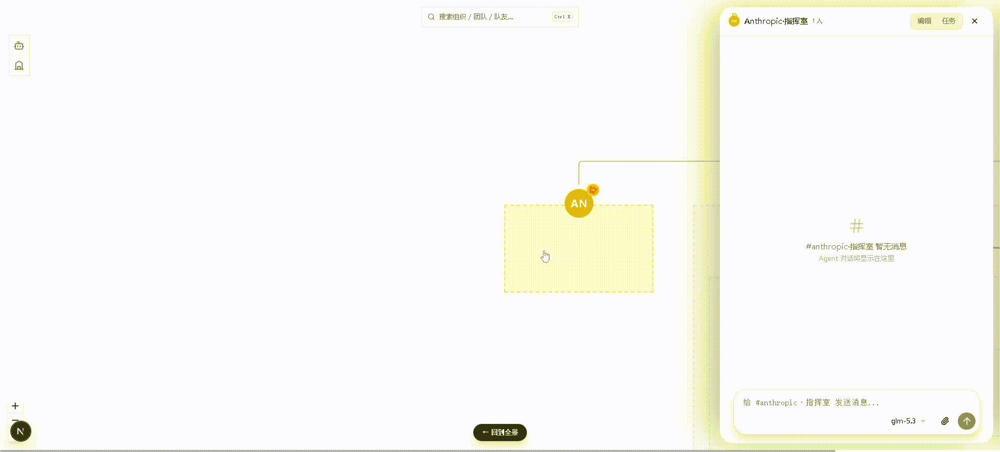
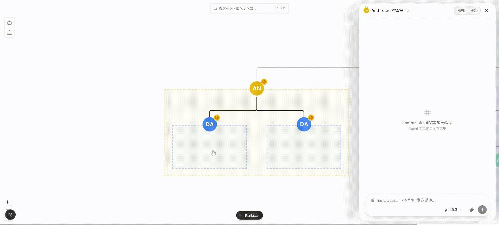
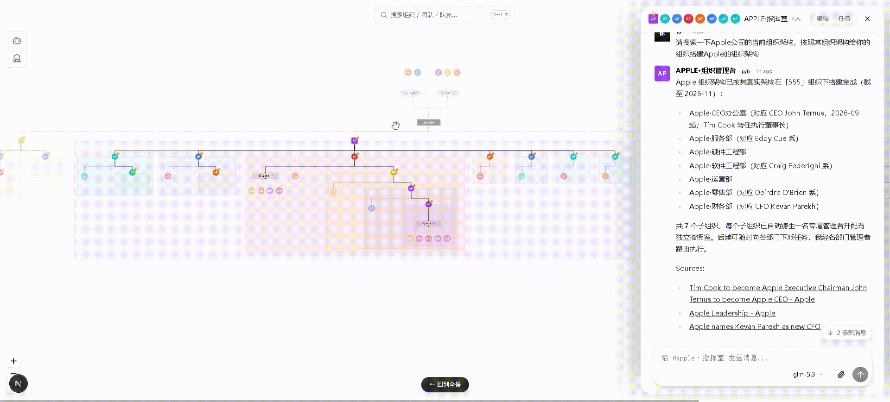

# TinyAIOrg

<div align="center">

[](https://github.com/wenroubinglen/TinyAIOrg/stargazers)
[](https://github.com/wenroubinglen/TinyAIOrg/network/members)
[](https://github.com/wenroubinglen/TinyAIOrg/issues)
[](./LICENSE)
[](README.md)
[](README.en.md)

[简体中文](README.md) · **English**

</div>

**TinyAIOrg** is an AI project built on a self-developed multi-agent collaboration and communication architecture. It uses a multi-level organization tree to enable infinitely nestable multi-agent communication — bringing your AI teammates, teams, and organizations into a single page: org charts, a 3D sky city, all operable directly in the browser, with all data staying on your machine. I believe that with or without AGI in the future, everyone deserves an army of organizations behind them — this should not be the exclusive privilege of big corporations. Use it for R&D, organization management, and any complex scenario that requires massive agent collaboration.

<p align="center">
  <a href="#demos">Demos</a> · <a href="#features">Features</a> · <a href="#prerequisites">Prerequisites</a> · <a href="#getting-started">Getting Started</a> · <a href="#development">Development</a> · <a href="#tech-stack">Tech Stack</a>
</p>

---

## Demos

**Quickly Create Members, Teams & Organizations** — right-click the canvas to create, or simply ask a member to create; quickly focus on whoever you want to give instructions to:



**Build Infinitely Nestable, Deeply Complex Org Structures** — drawer-style conversations with orgs/teams/members; organizations can nest endlessly, no matter how complex the structure:



**3D Sky City** — a visual world of your org tree and teammates; click a teammate or an organization to jump straight into member and team conversations:



---

## Features

- **Teammates (Agents)**: create/edit AI teammates, identity cards, skill panels, scheduled tasks, snapshot area
- **Teams**: team chat rooms, member management, team-level scheduled tasks
- **Organizations (Orgs)**: infinitely nestable org trees
- **3D Sky City**: visualization of org structures and teammates — click a member to jump straight into their conversation
- **Settings**: model configuration, web search

---

## Prerequisites

- Node.js ≥ 20 (bun is also fine for managing dependencies)
- The pyb engine installed locally (npm package `pybao-xc-sdk`):

```bash
npm install -g pybao-xc-sdk
pyb daemon start   # start the resident engine (defaults to 127.0.0.1:3779)
```

> No need to configure model providers or API keys in this step — after TinyAIOrg starts, finish the setup in "Settings → Models".

## Getting Started

```bash
git clone https://github.com/wenroubinglen/TinyAIOrg.git && cd TinyAIOrg
bun install        # or npm install
bun run dev        # or npm run dev → http://localhost:3000
```

Make sure the daemon is running (started in the previous step; `pyb daemon status` checks the state at any time, `pyb daemon stop` stops it).

### Connecting to a Custom Port

Top-right Settings → Connection lets you override the API endpoint manually (persisted to localStorage); build-time `NEXT_PUBLIC_API_URL` is also supported.

---

## Development

```bash
bun run build   # next build (output in .next/)
bun run lint    # eslint
```

---

## Tech Stack

| Category | Technology |
|------|------|
| Framework | Next.js 16 (App Router) |
| UI | React 19 · Tailwind CSS 4 |
| State | Zustand-free (React state primitives) |
| Canvas | @xyflow/react |
| 3D | Three.js / @react-three/fiber |
| Highlighting | shiki |

---

## ⭐ Star History

If this project helps you, please consider giving it a ⭐ Star so more people can discover TinyAIOrg.

<a href="https://www.repostars.dev/?repos=wenroubinglen%2FTinyAIOrg&theme=ocean">
  
</a>

---

## License

[MIT](./LICENSE)
