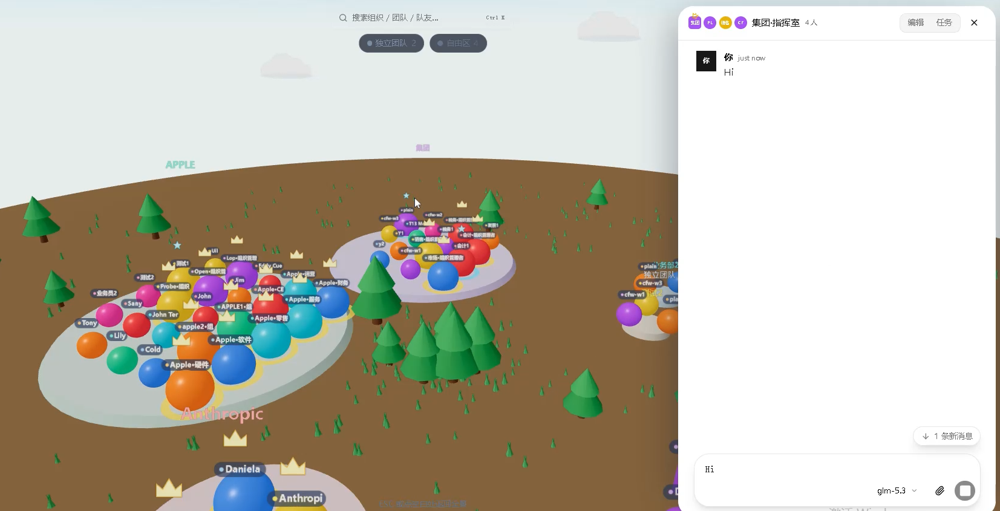
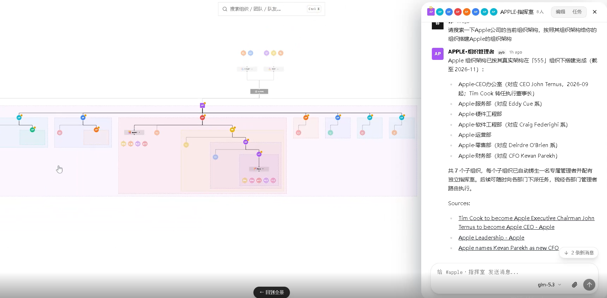
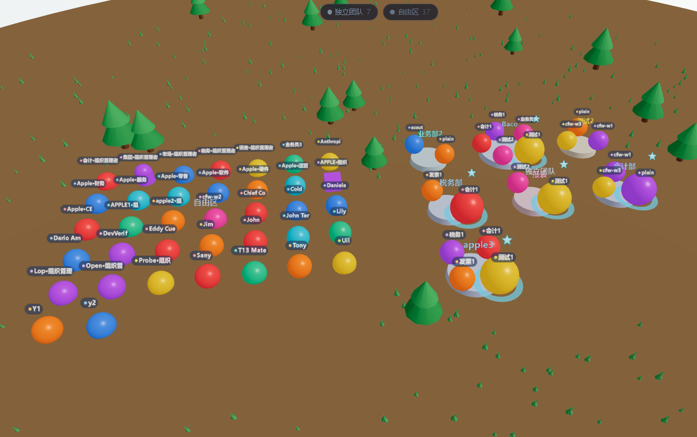
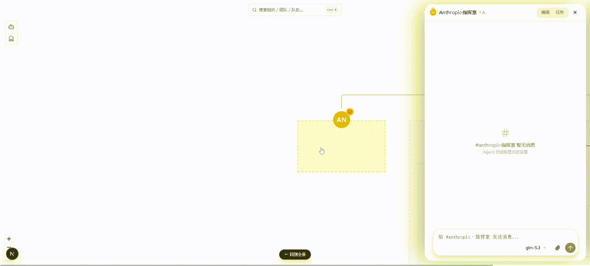
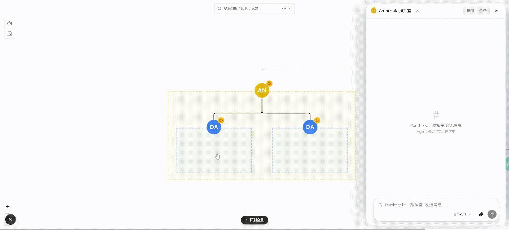
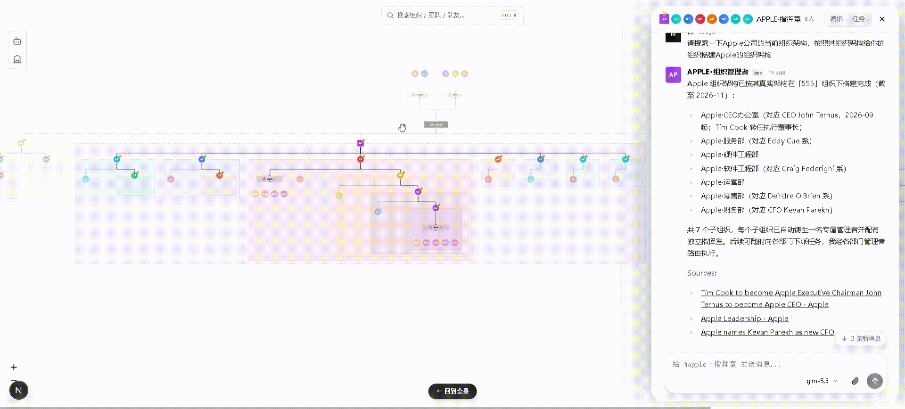

<div align="center">

# TinyAIOrg

[](https://github.com/wenroubinglen/TinyAIOrg/stargazers)
[](https://github.com/wenroubinglen/TinyAIOrg/network/members)
[](https://github.com/wenroubinglen/TinyAIOrg/issues)
[](./LICENSE)
[](README.md)
[](README.en.md)

**简体中文** · [English](README.en.md)

</div>

**TinyAIOrg** 项目通过多层级组织树方式实现无限嵌套多智能体通信的AI项目——我相信不管未来有没有AGI，每个人背后可以是无数组织的组合，这不应该是大公司独一无二的密码，用来做研发，组织管理，以及任何需要大量智能体协助的复杂场景。

<p align="center">
  <a href="#演示">演示</a> · <a href="#功能">功能</a> · <a href="#注意事项">注意事项</a> · <a href="#前置要求">前置要求</a> · <a href="#启动">启动</a> · <a href="#开发">开发</a> · <a href="#技术栈">技术栈</a>
</p>

---

## 演示

### 界面预览

<table>
  <tr>
    <td width="33%" align="center" valign="top">
      
    </td>
    <td width="33%" align="center" valign="top">
      
    </td>
    <td width="33%" align="center" valign="top">
      
    </td>
  </tr>
</table>

**快速创建成员，团队，组织** —— 右键画布创建或直接让成员创建，快速聚焦你的需要下达指令对象：



**创建极度复杂无限嵌套的组织机构** —— 与组织/团队/成员抽屉式会话，组织可以无限嵌套延伸，在复杂的组织机构也能创建：



**3D 天空之城** —— 组织树与队友的可视化世界，点开队友或者组织即达成员和团队会话：



---

## 功能

- **队友（Agents）**：创建/编辑 AI 队友、身份卡、技能面板、定时任务、快照区
- **团队（Teams）**：团队聊天室、成员管理、团队级定时任务
- **组织（Orgs）**：无限层级组织树
- **3D天空之城**：组织结构与队友的可视化，点开成员即达会话
- **设置**：模型配置、Web 搜索

---

## 注意事项

> 1. ⚠️ **当前仅支持 Windows 系统**，Linux 与 macOS 将在后续版本支持。
> 2. 🔥 **组织支持多层嵌套，层数越深 Token 消耗越大，可能急剧膨胀**——请谨慎测试使用，建议先从小规模组织开始。
> 3. 🚧 **项目仍在快速迭代中，功能可能不稳定**——遇到问题请及时通过[联系方式](#联系方式)反馈，或直接提 [Issues](https://github.com/wenroubinglen/TinyAIOrg/issues)。

---

## 前置要求

- Node.js ≥ 20.18.1（本仓开发用 bun 管理依赖亦可）
- 本机已安装并配置 pyb 引擎（npm 包名 `pybao-xc-sdk`，无需单独安装 daemon 组件）：

```bash
npm install -g pybao-xc-sdk
pyb daemon start   # 启动常驻引擎（已在运行则为 no-op）
```

> - Windows 用户建议在**管理员权限终端**执行安装，避免 PowerShell 执行策略 / EPERM 权限报错。
> - `pyb daemon start` 会在当前终端启动常驻引擎，**保持该终端开启**；新开终端可用 `pyb daemon status` 随时确认存活（`pyb daemon stop` 停止）。
> - 模型供应商与 API Key 无需在此步配置——启动 TinyAIOrg 后在「设置 → 模型」页完成配置。

## 启动

```bash
git clone https://github.com/wenroubinglen/TinyAIOrg.git && cd TinyAIOrg
bun install        # 或 npm install
bun run dev        # 或 npm run dev → http://localhost:3000
```

打开 http://localhost:3000 后，若页面提示连接失败，先回终端执行 `pyb daemon status` 确认引擎存活，再刷新页面。

### 连接自定义端口

右上角设置 → 连接，可手动覆盖 API 端点（持久化到 localStorage）；也支持构建期 `NEXT_PUBLIC_API_URL`。

---

## 开发

```bash
bun run build   # next build（产物 .next/）
bun run lint    # eslint
```

---

## 技术栈

| 类别 | 技术 |
|------|------|
| 框架 | Next.js 16 (App Router) |
| UI | React 19 · Tailwind CSS 4 |
| 状态 | Zustand-free（React 状态原语） |
| 画布 | @xyflow/react |
| 3D | Three.js / @react-three/fiber |
| 高亮 | shiki |

---

## ⭐ Star History

如果这个项目对你有帮助，欢迎点一个 ⭐ Star，让更多人发现 TinyAIOrg。

<a href="https://www.repostars.dev/?repos=wenroubinglen%2FTinyAIOrg&theme=ocean">
  
</a>

---

## 联系方式

📧 **联系邮箱**：[993226090@qq.com](mailto:993226090@qq.com)

💬 **微信号**：wenroubingleng

使用过程中有问题、想反馈 Bug 或洽谈合作，欢迎发邮件或加微信联系，也可以直接提 [Issues](https://github.com/wenroubinglen/TinyAIOrg/issues)。

---

## License

[MIT](./LICENSE)
